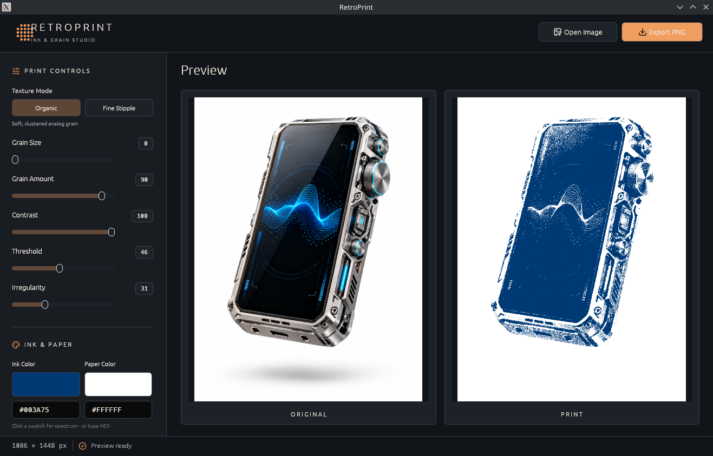

# RetroPrint

RetroPrint is a compact, offline, cross-platform Rust desktop app that turns photographs and renders into two-color, irregular stipple/retro-print artwork. It is inspired by analog grain, halftone, threshold, and duotone workflows.



The editor offers nine rendering modes, from organic stipple and blue-noise dots to hard threshold, ordered Bayer screens, and error diffusion. Pixel-based modes have independent Pixel Size and Dither Strength controls. Colors, alpha-safe transparent paper, and lossless indexed-PNG and vector SVG export are supported.

The UI uses the official [Lucide](https://lucide.dev/) vector icon set for buttons, controls, import affordances, and status indicators. Icons are bundled into the executable; no separate font or installation is required.

The [GitHub Actions workflow](.github/workflows/rust.yml) checks formatting, linting, and tests on pushes/PRs, then builds Linux x86-64 and Windows x86-64 ZIPs plus a Flatpak bundle. Push a `v*` tag to publish all three as GitHub Release assets.

## Features

- Drag-and-drop or open a PNG, JPEG, or still WebP. Click the empty preview area to browse; drops also accept readable file handles when a direct path is unavailable.
- Side-by-side previews or draggable Wipe Compare, with nearest-neighbor processed image sampling.
- Nine texture modes: Organic, Fine Stipple, Threshold, Bayer 4×4, Bayer 8×8, Halftone Dots, Line Screen, Floyd–Steinberg, and Atkinson.
- Independent Pixel Size and Dither Strength controls for pixel-based modes; Grain Size and Grain Amount for Organic/Fine, plus Contrast, Threshold, conditional Blur and Irregularity.
- Independently customizable ink and paper colors, with 2D spectrum pickers, `#RRGGBB` inputs, and six one-click palettes.
- Transparent Paper option for print-ready cutouts.
- Seven one-click print recipes, deterministic seed, Reseed, and Reset.
- Save original-resolution PNG or SVG in a background thread. PNG uses lossless indexed color when possible; SVG merges horizontal and vertical pixel runs into vector rectangles and retains transparency.
- No cloud, telemetry, Python, Photoshop, OpenCV, or FFmpeg.

## Build and run

Install an up-to-date stable Rust toolchain, plus the usual native Linux development dependencies for egui/winit. On an Arch Linux KDE desktop, make sure the Wayland/X11 development environment, D-Bus, and the XDG desktop portal are present.

**Dolphin drag-and-drop on KDE Plasma Wayland:** RetroPrint prefers the X11/XWayland window backend on Linux whenever `DISPLAY` is set. This routes Dolphin-to-window drops through X11 DnD events. XWayland is typically available in Plasma; install `xorg-xwayland` if needed. If `DISPLAY` is absent, the app keeps native Wayland as a startup fallback. Dropped files are read by path or by file bytes when the portal provides them. This behavior still needs an interactive KDE test.

```bash
cargo run --release
```

To open an image immediately (also useful for GUI smoke tests):

```bash
cargo run --release -- /path/to/image.png
```

Produce an executable without running:

```bash
cargo build --release
```

The binary will be `target/release/retroprint` on Linux. The same Cargo project can be built for Windows/macOS with their respective Rust toolchains and build dependencies.

The GitHub Actions artifact `retroprint-linux-x86_64.zip` includes a prebuilt Linux x86-64 executable named `retroprint` at the archive root. On a compatible glibc-based Linux desktop, extract the ZIP, then run:

```bash
chmod +x retroprint
./retroprint
```

That executable is a convenience build, not an AppImage or a statically linked universal Linux package. If it does not start because of graphics/session/runtime compatibility, compile locally with Cargo instead.

### Windows executable

Download `retroprint-windows-x86_64.zip` from the GitHub release, extract it, and double-click `retroprint.exe`. This is a portable executable; no installer or separate asset files are required. Windows may show a SmartScreen warning because the executable is not code signed. The Windows build runs tests in GitHub Actions, but interactive desktop behavior should also be checked on a Windows machine.

### Flatpak bundle

The release also includes `retroprint-linux-x86_64.flatpak`. With Flatpak installed, download the bundle and run:

```bash
flatpak install --user ./retroprint-linux-x86_64.flatpak
flatpak run io.github.tzerokyi.RetroPrint
```

Flatpak installs the executable with its launcher, so there is no separate `chmod` step. The first installation may download the Freedesktop 26.08 runtime from Flathub. This bundle uses X11/XWayland for the desktop window and the file chooser portal for file access; it does not request network access. A desktop with XWayland support is required. The bundle is distributed through GitHub Releases, not Flathub's app catalog.

The standalone bundle is a direct download, not a software-store listing or an automatic update source. Software centers may show limited publisher details or omit screenshots when inspecting the bundle. The project metadata includes a developer name and a screenshot URL for a future public Flatpak repository; the screenshot URL becomes accessible when this GitHub repository is public.

## Usage

1. Drag an image into the window or click **Open Image**.
2. Choose a print recipe or one of nine **Texture Mode** engines. Organic and Fine preserve their granular appearance; pixel-based modes create ordered, binary, or error-diffusion patterns.
3. In pixel-based modes, adjust **Pixel Size** to change the working grid, **Blur** to soften detail, and **Dither Strength** to change distribution where supported. In Organic/Fine, use **Grain Size** and **Grain Amount**.
4. Tune **Contrast**, **Threshold**, and, when applicable, **Irregularity** to shape the print.
5. Choose the **Ink** and **Paper** colors independently: click either swatch for its hue/saturation spectrum or type a six-digit HEX color (`#D45A36`); alternatively select a quick palette.
6. Optionally enable **Transparent Paper** to export only the printed ink. This is **not** semantic background removal: highlights and unprinted areas also become transparent.
7. Switch on **Wipe Compare** to drag a divider across the previews, or keep the default side-by-side view. Click **Export PNG** or **SVG** to save.

The app preserves original input alpha. Both exports use the original image dimensions; previews are intentionally reduced for responsiveness. On export, the app checks how many distinct RGBA colors are actually used. It automatically encodes up to 256 unique colors as a lossless 1-, 2-, 4-, or 8-bit indexed PNG (typically only **1 bit per pixel** for opaque two-color prints); images with more than 256 RGBA colors use full RGBA PNG. This is pixel-for-pixel reversible, without color reduction, resampling, or manual RGB conversion. File sizes vary with image dimensions and texture complexity.

## Tests

```bash
cargo fmt --check
cargo clippy --all-targets --locked -- -D warnings
cargo test --locked
```

## Source layout

| File | Purpose |
| --- | --- |
| `src/main.rs` | GUI, asynchronous preview/export workers, drag-and-drop, file dialogs |
| `src/ui.rs` | Full-window UI layout, theme, embedded Lucide icons, preview rendering |
| `src/effect.rs` | CPU image processing and unit tests |
| `src/image_io.rs` | Import, previews, PNG encoding and merged-rectangle SVG export |
| `src/presets.rs` | Default parameters and colors |
| `assets/icons/` | Official Lucide SVG icons and their upstream license notice |
| `assets/noise/` | Christoph Peters's CC0 blue-noise mask and license notice |
| `assets/retroprint-preview.png` | Screenshot of the running app |
| `flatpak/` | Flatpak manifest, launcher, icon, metadata, and offline Cargo sources |

## Limitations

- The print engines are original rendering implementations, not clones of proprietary filters.
- No automatic object segmentation or background removal.
- No ICC color-management pipeline or guaranteed exact print color reproduction.
- Very large images can consume considerable memory before input limits are evaluated.
- Preview and output use the same rendering pipeline and relative pixel-grid scale, but resampling means individual pixels may differ.

## License

The RetroPrint source is MIT-licensed (see `LICENSE`). The bundled Lucide icons retain their upstream ISC/MIT licensing and attribution; see `assets/icons/LUCIDE_LICENSE.txt`. The blue-noise mask is by Christoph Peters under CC0 1.0; see `assets/noise/LICENSE.txt`.
